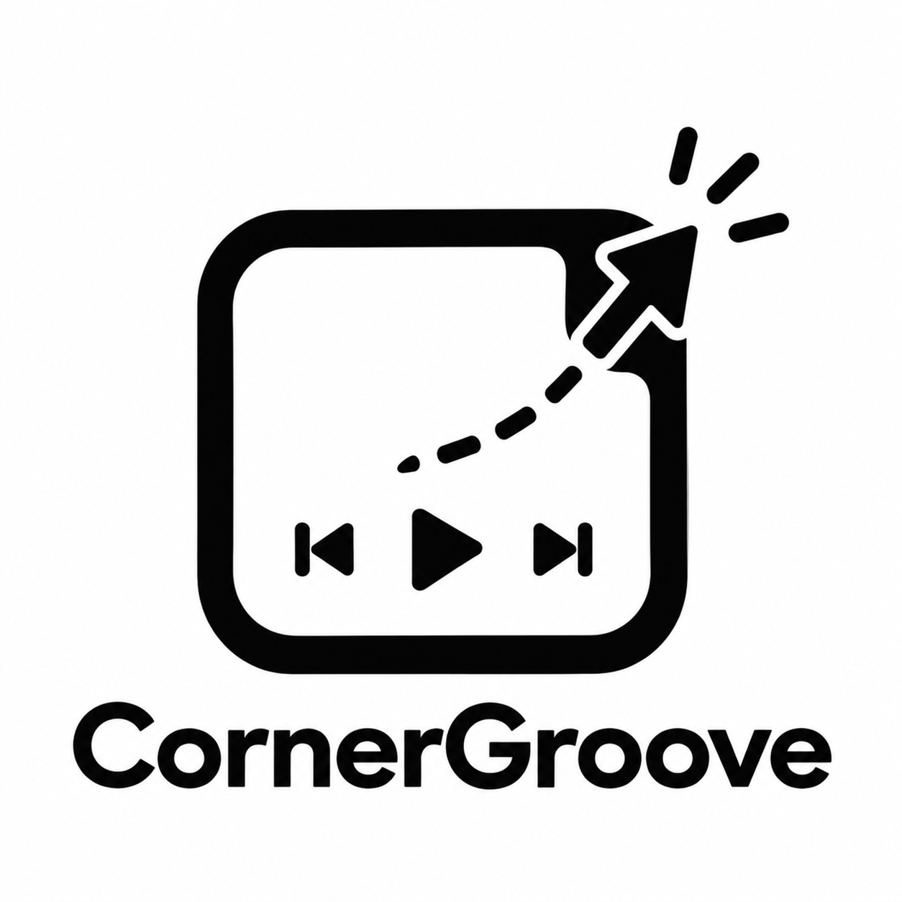

<p align="center">
  
</p>

<h1 align="center">CornerGroove</h1>

<p align="center">
  <strong>A minimalist, edge-docked vinyl music widget &amp; per-application volume mixer for Windows 10 &amp; 11</strong><br>
  <em>Flat soft UI, smooth theme transitions, in-game overlay hotkey, and left-edge blurred radial aura.</em>
</p>

<p align="center">
  <a href="https://github.com/CornerGroove/CornerGroove/releases/tag/v1.0.0"></a>
  <a href="LICENSE"></a>
  
  
</p>

---

Tucked discreetly into the bottom-right corner of your screen, **CornerGroove** stays hidden until you slide your cursor into the corner or press the configurable in-game hotkey—smoothly gliding into view with your active music playback, spinning vinyl disc artwork, blurred radial aura glow, and a complete system per-app volume mixer.

---

## 📦 Downloads (GitHub Releases)

Download precompiled standalone binaries from the [GitHub Releases](https://github.com/CornerGroove/CornerGroove/releases/latest) page:
- **Direct Executable:** [`CornerGroove.exe`](https://github.com/CornerGroove/CornerGroove/releases/download/v1.0.0/CornerGroove.exe)
- **Portable Zip Archive:** [`CornerGroove-v1.0.0-windows-x64.zip`](https://github.com/CornerGroove/CornerGroove/releases/download/v1.0.0/CornerGroove-v1.0.0-windows-x64.zip)

---

## ✨ Features

- **Abstract Radial Blurred Aura (Left Edge Glow)**:
  - Emanates from behind the spinning vinyl disc on the left side of the widget card.
  - Atmospheric dual-orb radial gradient that dynamically matches your active theme palette (Emerald, Cyan, Violet, Caramel).
  - Cleanly clipped to the card's rounded corners—no harsh boxes or overflow artifacts.

- **In-Game Overlay Hotkey & Cursor Restore**:
  - Global hotkey support (`F8`, `F9`, `F10`, `Ctrl+Shift+M`, or Off) configurable directly in Settings.
  - Instantly summons CornerGroove on top of fullscreen or borderless games.
  - Unlocks mouse cursor capture and places the cursor right onto widget controls so you never lose control in games.

- **Custom-Styled Interactive Sliders**:
  - Polished master and per-application volume sliders with rounded tracks and subtle indicator thumbs.
  - Seekable music progress bar with real-time feedback and dynamic hover indicator.

- **Clean Typography (Zero Artificial Badges)**:
  - Source app information (Spotify, YouTube, Tidal, etc.) presented in clean typography alongside the sound wave visualizer.

- **Smooth Animated Theme Transitions**:
  - 60fps color interpolation across all theme brushes and aura gradients.
  - Zero abrupt color snapping when switching themes—everything glides into the new colorway.

- **Corner Edge-Slide Trigger**:
  - Sits tucked against the right screen edge with a subtle 4px handle.
  - Hovering into the bottom-right screen corner or handle triggers a smooth cubic ease-out slide-in.
  - Auto-hides after 1.3 seconds when cursor leaves (unless pinned).
  - `ShowActivated="False"` ensures it never steals focus from active work or game windows during mouse hovering.

- **Vinyl Record & Sleeve Animation**:
  - Displays album artwork with rounded corners.
  - Half of the vinyl record sticks out with grooved tracks and center label.
  - **Spins in real-time** when playing (`IsPlaying`), and freezes smoothly in place when paused.

- **3-Bar Sound Wave Visualizer**:
  - Dynamic 3-bar sound wave in the header.
  - Animated heights when music is playing, settles and dims when stopped.

- **Per-Application Volume Mixer (WASAPI Core Audio)**:
  - Hover or click the **Volume icon (🔊)** to reveal the upper **Mixer Panel**.
  - **Master Volume Slider** with one-click Mute toggle.
  - **App Mixer**: Lists active audio-producing applications (e.g., Spotify, Chrome, Firefox, Discord, games) with high-resolution icons, individual volume sliders, and mute toggles.
  - Only actual audio sessions are listed—no background process clutter.

- **"Open Last Played" Memory**:
  - Remembers the last played song title, artist, and source application.
  - When nothing is playing, displays an **"Open [App]"** button that immediately launches or focuses the app so you can resume listening in one click.

- **Theme Engine (4 Built-in Themes)**:
  - 🌙 **Dark** (Deep obsidian `#0C0C0E` + Emerald `#10B981`)
  - ☀️ **Light** (Crisp silver `#F4F4F6` + Teal `#0D9488`)
  - 🧛 **Dracula** (Iconic `#282A36` + Purple `#BD93F9` & Green `#50FA7B`)
  - ☕ **Cappuccino** (Warm espresso & caramel tones `#2A231F` + `#D4A373`)

- **Tactile Toggle Switches**:
  - Clean switches for "Always on Top" and "Start with Windows".

- **Clean Custom Context Menu**:
  - Custom styled WPF tray context menu with zero white icon gutters.

- **Universal Media Capture (Windows SMTC)**:
  - Native integration with `GlobalSystemMediaTransportControlsSessionManager`:
    - **Spotify** (Desktop & Web)
    - **YouTube / YouTube Music** (Chrome, Edge, Brave, Firefox, Opera)
    - **Apple Music, Tidal, Deezer, VLC, Windows Media Player**

---

## 🎨 Themes Showcase

| Theme | Background | Card | Aura Accents | Text |
| :--- | :--- | :--- | :--- | :--- |
| **Dark** | `#0C0C0E` | `#131317` | Emerald `#10B981` • Cyan `#06B6D4` | `#EDEDED` |
| **Light** | `#F4F4F6` | `#FFFFFF` | Teal `#0D9488` • Sky `#38BDF8` | `#18181B` |
| **Dracula** | `#1E1F29` | `#282A36` | Purple `#BD93F9` • Pink `#FF79C6` | `#F8F8F2` |
| **Cappuccino** | `#1E1916` | `#2A231F` | Caramel `#D4A373` • Amber `#F59E0B` | `#FDFBF7` |

---

## 🚀 Getting Started

### Build from Source
Requirements: [.NET 9.0 SDK](https://dotnet.microsoft.com/download/dotnet/9.0) on Windows 10/11.

```powershell
git clone https://github.com/CornerGroove/CornerGroove.git
cd CornerGroove
dotnet build -c Release
dotnet run -c Release
```

---

## ⌨️ Shortcuts & Controls

- **F8 (or custom hotkey)**: Toggles widget & unlocks/positions mouse cursor over widget in fullscreen games.
- **Hover bottom-right screen edge**: Slides widget into view.
- **Pin Icon (📌)**: Keeps widget permanently visible on top of all windows.
- **Volume Icon (🔊)**: Toggles master and per-application volume mixer panel.
- **Gear Icon (⚙)**: Opens Settings, Theme selector, and In-Game Hotkey config.
- **Click progress bar**: Seeks forward or backward in the track.
- **System Tray Icon**: Right-click for context menu; left-click to toggle widget.

---

## 📄 License

MIT License — see [LICENSE](LICENSE) for details.
